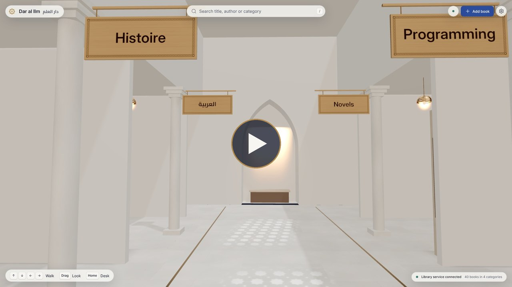
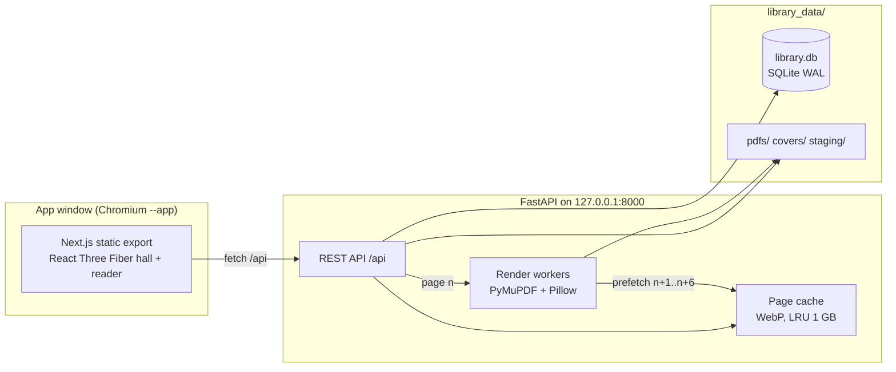

<div align="center">


# Dar al Ilm · دار العلم

**Your PDF library, as a place you can walk through.**

A private, offline 3D library for your own books — English, French and Arabic, scanned or
digital. Shelves you can stroll past, plaques that read right to left, and a reader whose pages
really turn.


<br>

<a href="docs/media/dar-al-ilm-tour.mp4"></a>

<sub><a href="docs/media/dar-al-ilm-tour.mp4"><b>Watch the 60-second tour</b></a> (MP4, 1080p, 9 MB): walking the hall, an Arabic search with
the camera flight to the book, opening it, right-to-left page turns, and the interface in Arabic.
Captured from the real app frame by frame.</sub>

</div>

---

## Why

Downloaded books pile up in `Documents/` and `Downloads/`: no categories, no reading progress,
and PDF viewers that only scroll. Dar al Ilm gives every book a place on a shelf in a calm,
modern reading hall with Arabic design accents. You come back to the books you were reading,
find any title in a second, and read with real page turns: left to right for English and
French, right to left for Arabic.

Everything stays on your machine. No account, no cloud, no telemetry.

## Highlights


| | |
|---|---|
| **A hall you can walk** | Arrow keys or WASD to walk, drag to look around, `Home` back to the entrance desk. Collision keeps you out of the shelves. |
| **Books with presence** | Spines are as thick as the book is long and as tall as its pages; their colour comes from the cover. Hover to slide a book out, click to see its cover. |
| **Arabic done right** | Category plaques and spine titles are drawn with real Arabic shaping (Cairo font), the whole UI mirrors to right-to-left, and Arabic books turn from right to left. |
| **A reader that feels like paper** | Curved 3D pages, a soft preview while a page turns and a sharp image when it lands, zoom to 400 % into tables, automatic bookmarks. |
| **Currently reading** | The entrance desk always holds the three books you opened last. |
| **Search that understands you** | Type part of a title, author or category; diacritics, alef forms and French accents are ignored. The camera flies to the book. |
| **Scanned books welcome** | Image-only PDFs import in about 0.1 s and render fast thanks to a page cache and prefetching. |
| **Private by design** | Runs on `127.0.0.1` only, makes zero external requests, and protects the local API against other websites. |

## Project status

Built story by story with a spec-driven Scrum process (`AGENTS.md`, `PROGRESS.md`). All 16
stories are done.

| Sprint | Scope | Status |
|---|---|---|
| 1 · Backend | FastAPI, SQLite, PyMuPDF import, page streaming, cache | **Complete** |
| 2 · 3D reader | Next.js scaffold, curved page mesh, progressive textures, zoom | **Complete** |
| 3 · 3D hall | Hall, plaques, shelves, hover, search flight, desk | **Complete** |
| 4 · UI and launch | Modals, English/Arabic UI, diagnostics, `start.sh` | **Complete** |

## Quick start

Requirements: Linux, Python 3.12 or newer, Node.js 20.9 or newer, and a Chromium-based
browser (Chromium, Chrome, Brave or Edge) for the app window. Firefox works in a normal tab.

### First time (needs internet once)

```bash
git clone https://github.com/makouaranas/Dar-al-ilm.git
cd Dar-al-ilm
./start.sh
```

The first start installs the pinned Python and npm packages (`scripts/setup.sh`), builds the
interface, creates your library folder and opens the app window. After that, nothing is ever
downloaded again: fonts, icons and textures are part of the app.

### Every day

```bash
./start.sh
```

The hall opens in its own window. Close the window to stop Dar al Ilm (or press `Ctrl+C` in the
terminal). Other ways to start:

| Command | What it does |
|---|---|
| `./start.sh --no-browser` | Serve on `http://127.0.0.1:8000` without opening a window; stop with `Ctrl+C`. |
| `./start.sh --smoke` | Start, check `/api/health` and `/`, stop. Exits 0 when both answer. |
| `./start.sh --dev` | API with auto-reload on port 8000 and the Next.js dev server on `http://127.0.0.1:3000`. |

If port 8000 is busy (for example Dar al Ilm is already running), `start.sh` says so and stops
without touching the other program.

### First steps in the hall

1. Create a category on the welcome card (or pick a suggestion such as **Programming**).
2. Choose **Add book**, or drop a PDF anywhere in the hall. Title, category and reading
   direction are required; Arabic titles pre-select right to left.
3. Walk with the arrow keys or WASD, drag to look around, press `/` to search and `Home` to
   return to the entrance desk. Click a book to present it, then **Open** to read.
4. **Settings** (the gear at the top) switches between English and Arabic, the graphics preset
   (Auto, Performance, High) and the ambient light, and manages categories.

### Your library folder

Everything lives in `library_data/` next to `start.sh` (or in `DAR_DATA_DIR` if you set it):

```
library_data/
├── library.db        catalogue, bookmarks and settings (SQLite)
├── pdfs/             your books, stored as book_{id}.pdf
├── covers/           cover images
├── cache/            rendered pages (safe to delete; rebuilt on demand)
└── staging/          imports not saved yet (purged after 24 h)
```

**Back up** by stopping Dar al Ilm and copying the whole `library_data/` folder; restore by
putting it back. The database stores relative paths only, so the folder can move to another
machine or disk.

## Explore the backend on its own

```bash
./scripts/setup.sh --backend          # creates backend/.venv and installs pinned packages

cd backend
# Optional: a demo library with 40 generated English, French and Arabic books (about 30 s)
.venv/bin/python scripts/seed_demo.py --data-dir /tmp/dar-demo

DAR_DATA_DIR=/tmp/dar-demo .venv/bin/uvicorn app.main:app --host 127.0.0.1 --port 8000
```

Then open:

- `http://127.0.0.1:8000/api/health` — the service is up
- `http://127.0.0.1:8000/api/bootstrap` — categories, books, the desk and settings in one payload
- `http://127.0.0.1:8000/api/books/31/page/3?quality=high` — an Arabic demo page, rendered on the fly
- `http://127.0.0.1:8000/api/books/36/page/5?quality=zoom` — a scanned demo page at zoom quality

Without `DAR_DATA_DIR`, the library lives in `library_data/` at the repository root.

### Import your own PDF

```bash
# 1. Stage and analyse the file (page count, cover preview, suggested title and direction)
curl -s -H 'X-Dar-Client: 1' -F 'pdf_file=@/path/to/book.pdf' http://127.0.0.1:8000/api/uploads

# 2. Save it as a book (use the upload_id from step 1 and an existing category id)
curl -s -H 'X-Dar-Client: 1' \
  -F upload_id=<upload_id> -F title='My book' -F category_id=1 -F reading_direction=LTR \
  http://127.0.0.1:8000/api/books
```

Every request that changes data needs the `X-Dar-Client: 1` header: it keeps other websites in
your browser from touching your library.

## How it works



- **Import in two steps.** The PDF is staged and analysed first, so the form can show its cover
  and page count before you save. Saving moves it to `pdfs/book_{id}.pdf`; your original file can
  then be deleted.
- **Shelves fill like a real library.** Each book takes the first free slot in its category (30 per
  shelf); a slot freed by a deleted book is reused.
- **Pages at three qualities.** `low` (768 px) while a page is turning, `high` (2048 px) when it
  settles, `zoom` (4096 px) for small print. Rendered pages are cached and the next pages are
  prepared in the background.
- **Portable data.** The database stores relative paths only, so you can move or back up the whole
  `library_data/` folder.

Measured in the development container on a realistic 400-page scanned PDF (20 MB):

| Operation | Median |
|---|---|
| Import (count pages, read size, render cover) | 105 ms |
| Page from cache | 1.5 ms |
| New page, `low` | 29 ms |
| New page, `high` | 165 ms |
| New page, `zoom` | 448 ms |

## API at a glance

| Method | Path | Purpose |
|---|---|---|
| `GET` | `/api/health` | Service status |
| `GET` | `/api/bootstrap` | Categories, books, Currently Reading, settings |
| `POST · PATCH · DELETE` | `/api/categories[/{id}]` | Manage categories (`?move_to=` moves books before a delete) |
| `PATCH` | `/api/settings` | Language, default reading direction, graphics preset, ambient light |
| `POST · DELETE` | `/api/uploads[/{id}]` | Stage, preview and cancel a PDF import |
| `POST` | `/api/books` | Save a staged upload as a book |
| `PATCH · DELETE` | `/api/books/{id}` | Edit, bookmark, mark as opened, delete |
| `GET · PUT · DELETE` | `/api/books/{id}/cover` | Get, replace or revert the cover |
| `GET` | `/api/books/{id}/page/{n}?quality=low\|high\|zoom` | Page image (WebP) |

The full contract, with every field and error code, is in
[`docs/ARCHITECTURE.md`](docs/ARCHITECTURE.md#6-internal-rest-api-contract). The schema is also
served at `/openapi.json`.

## Development

```bash
cd backend
.venv/bin/pytest -v                                   # all backend tests
.venv/bin/pytest tests/test_perf.py -m perf -s        # latency report (informational)
.venv/bin/python -m compileall app                    # compile check

cd ../frontend
npm run typecheck                                     # TypeScript
npm run test:unit                                     # Vitest unit tests
npm run build                                         # static export to frontend/out/
npm run test:e2e                                      # Playwright, against a seeded demo library
npm run test:e2e -- us-13                             # one story's end-to-end tests
```

Tests generate every PDF they need (text, A5, rotated, Arabic titles, 400-page scans,
encrypted, empty, damaged) and always use a temporary library folder. The end-to-end tests
serve `frontend/out/` on port 8765, so build first.

### Configuration

| Variable | Default | Purpose |
|---|---|---|
| `DAR_DATA_DIR` | `<repo>/library_data` | Library folder |
| `DAR_PORT` | `8000` | Port on `127.0.0.1` |
| `DAR_RENDER_WORKERS` | CPU cores − 1 (max 4) | Page render processes; `0` renders in-process |
| `DAR_CACHE_LIMIT_MB` | `1024` | Page cache size |
| `DAR_MAX_UPLOAD_MB` | `2048` | Largest accepted PDF |

### Repository map

```
AGENTS.md              Agent contract: one story at a time, verification before done
PROGRESS.md            Live checklist of the 16 user stories
docs/REQUIREMENTS.md   Goals, scenarios, requirements, risks, decision log
docs/ARCHITECTURE.md   Versions, data model, API, rendering, hall layout, testing
docs/DESIGN.md         The look and feel: "light through geometry"
docs/sprints/          Four sprints, sixteen stories with acceptance criteria
backend/               FastAPI app, tests, demo seeding script
frontend/              Next.js + React Three Fiber app, unit and end-to-end tests
start.sh               One-click launcher
scripts/setup.sh       One-command environment setup
```

## Privacy and your data

- The server listens on `127.0.0.1` only; other devices on your network cannot reach it.
- Requests with a foreign `Host` header are refused (DNS rebinding), and data-changing requests
  need the `X-Dar-Client` header and the app's own origin (cross-site requests).
- Uploaded files are validated, size-capped and stored under internal names; your file names
  never become paths.
- Fonts, icons and textures are bundled with the app. It makes no request outside your
  machine.
- To back up your library, copy the `library_data/` folder.

## Design

The hall is a neutral, modern library with Arabic design accents: pale limestone, light ash
wood and brass, with daylight falling through mashrabiya screens into eight-point stars on the
floor. Typography pairs Inter and Cairo. See [`docs/DESIGN.md`](docs/DESIGN.md).

## License

[Apache License 2.0](LICENSE) © Anas Makouar.

<div align="center"><sub>دار العلم — a house of knowledge, on your own machine.</sub></div>
